# ScanDine (DineFlow) — QR Code Restaurant Ordering & Management System

A full-stack web application built with **Laravel 12**, **Tailwind CSS**, and **MySQL** that streamlines dine-in restaurant operations. Customers scan a table-specific QR code to browse the menu and place orders directly from their phones, while kitchen and floor staff manage live orders, table sessions, taxes, and receipts through a responsive management portal.

---

## Screenshots

### 1. Customer Mobile Ordering Flow

|                   QR Menu & Search                   |              Cart & Item Special Notes               |                     Live Order Status Tracker                     |
| :--------------------------------------------------: | :--------------------------------------------------: | :---------------------------------------------------------------: |
| 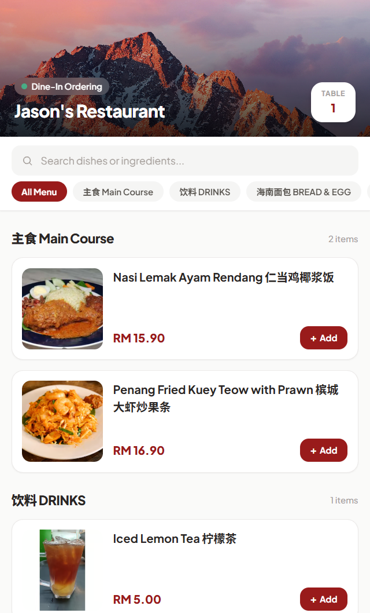 | 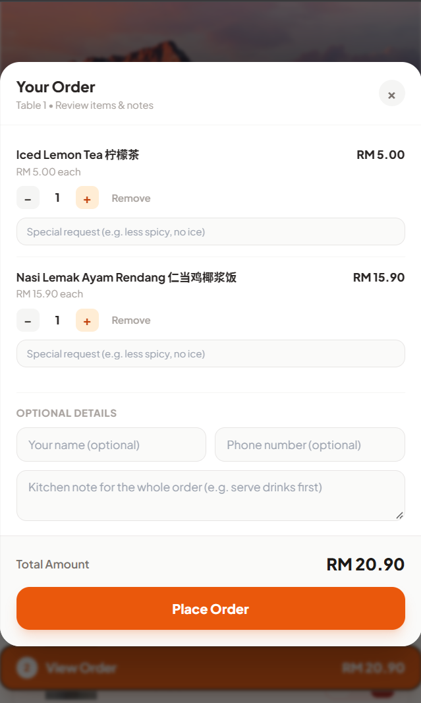 | 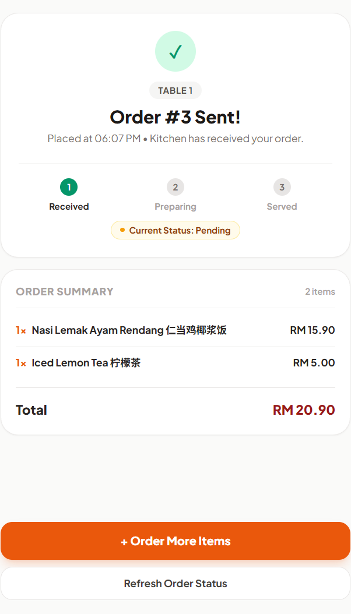 |

### 2. Staff & Kitchen Operations

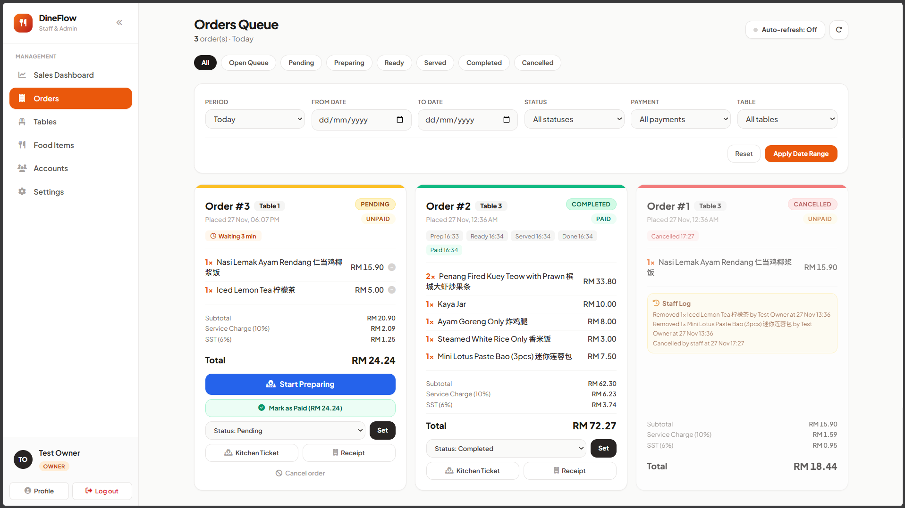

|               Table QR Management                |               Printable Table QR Slip                |                  Kitchen Print Ticket                  |                    Itemized Tax Receipt                    |
| :----------------------------------------------: | :--------------------------------------------------: | :----------------------------------------------------: | :--------------------------------------------------------: |
| 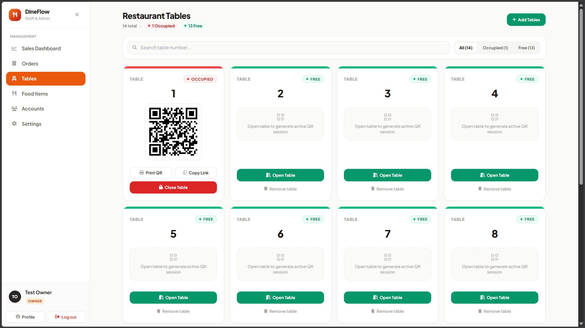 | 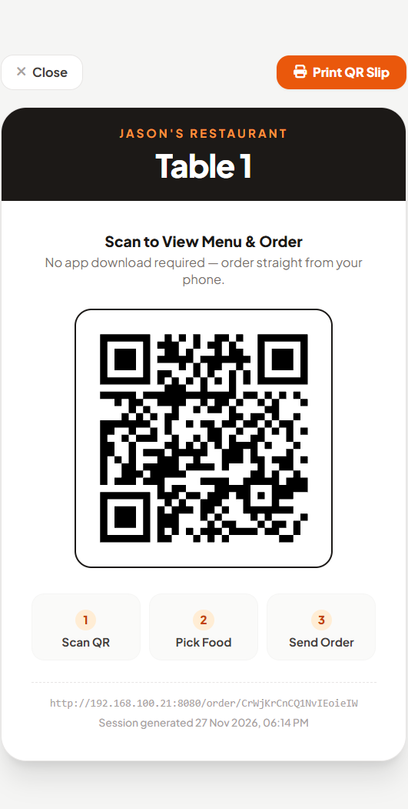 | 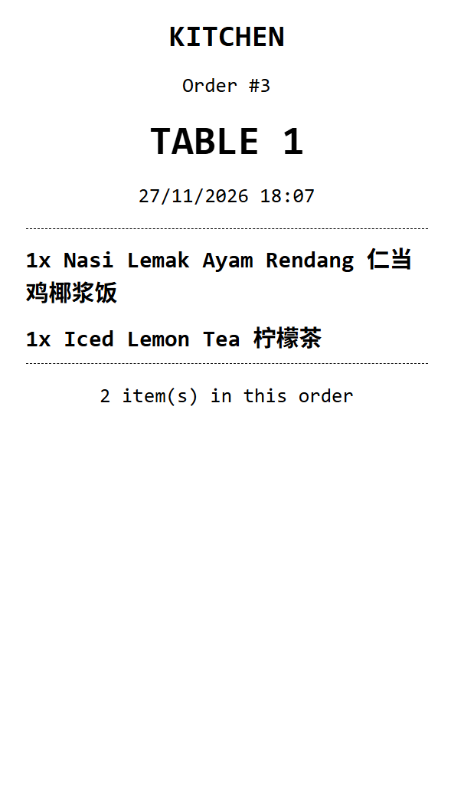 | 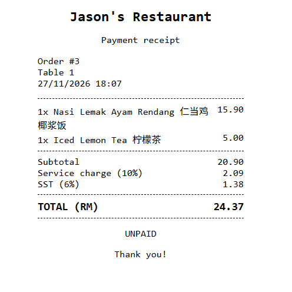 |

### 3. Admin Analytics & Store Configuration

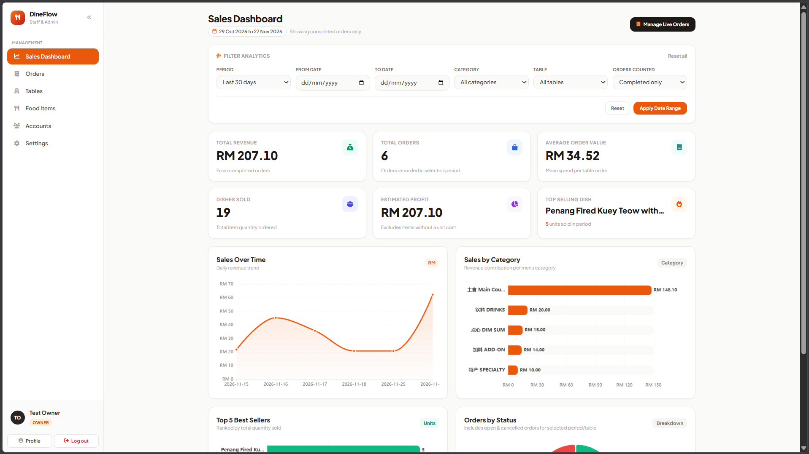

|            Menu & Stock Management             |             Dynamic Tax & Receipt Settings             |
| :--------------------------------------------: | :----------------------------------------------------: |
| 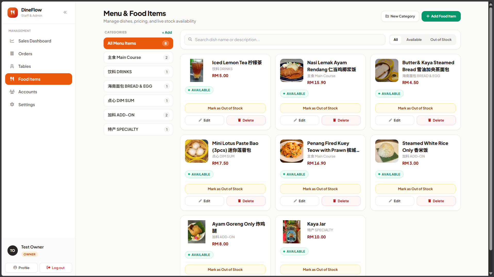 | 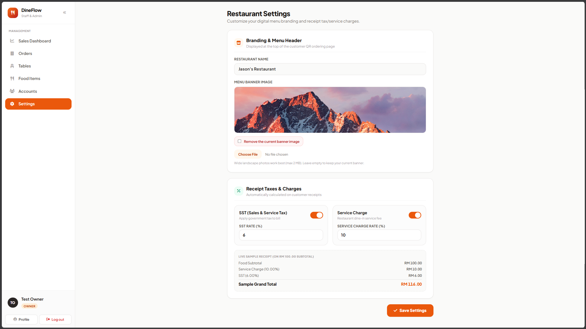 |

|               Role-Based Staff Accounts               |               Staff Portal Login                |
| :---------------------------------------------------: | :---------------------------------------------: |
| 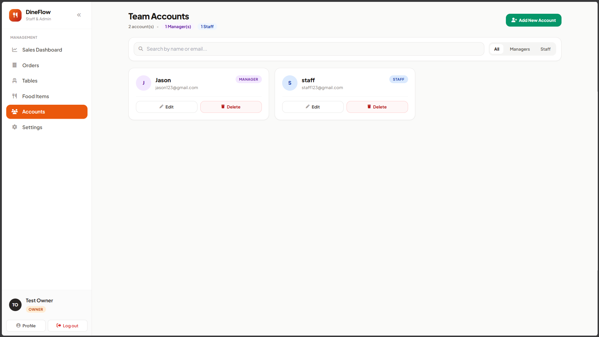 | 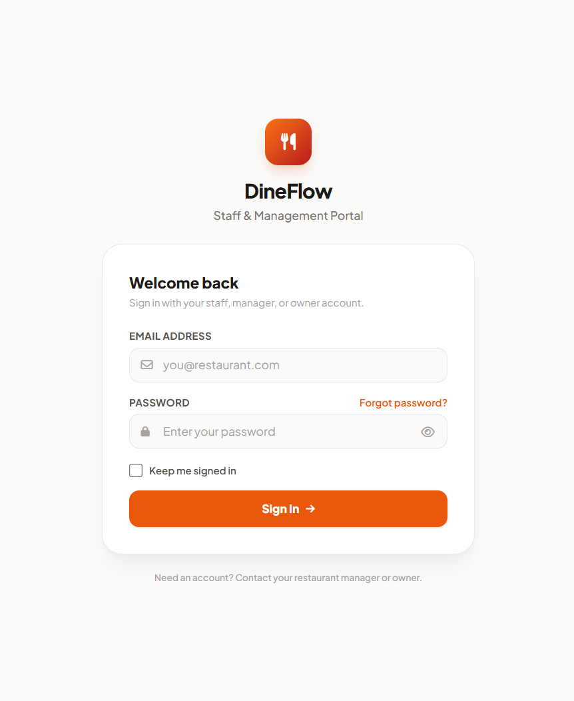 |

---

## Key Features

### Customer Self-Service Experience

- **Session-Based Table QR Codes:** Customers scan their table's active QR code to browse categories, search dishes, and order with zero app installation required.
- **Interactive Cart & Item Notes:** Supports quantity adjustments, item-level special requests, order-wide kitchen notes, and real-time order status tracking.
- **Daily Resetting Order Numbers:** Order numbers automatically start from **#1** each day for clean kitchen and counter coordination while maintaining unique database records for reporting.

### Staff & Kitchen Portal

- **SPA-Style Navigation:** Custom AJAX view swapping updates tabs, filters, and order statuses in place without full-page browser reloads, paired with a collapsible icon sidebar.
- **Live Order Queue:** One-tap status progression (`Pending` → `Preparing` → `Ready` → `Served` → `Completed`), payment tracking, wait-time indicators, and optional 30-second auto-refresh.
- **Item Removal & Audit Logs:** Authorized staff can remove out-of-stock items with optional reasons, automatically recalculating order totals and recording timestamped entries in the Staff Log.
- **Print-Ready Slips:** Dedicated print layouts for kitchen tickets, itemized customer receipts, and table QR slips.

### Administration & Configuration

- **Dynamic Tax & Charge Engine:** Configure restaurant details, **Service Charge (%)**, and **SST (%)** with a live receipt preview that automatically updates staff order cards and printed receipts.
- **Role-Based Access Control (RBAC):** Distinct permission levels for **Staff**, **Manager**, and **Owner** accounts.
- **Menu & Table Management:** Toggle item stock availability, organize food categories, and manage table QR sessions.

---

## Tech Stack

- **Backend:** PHP 8.2, Laravel 12
- **Frontend:** Blade Templates, Tailwind CSS, Plus Jakarta Sans, Font Awesome, Vanilla JS (SPA Fetch Engine)
- **Database:** MySQL 8.0
- **Build & Packages:** Vite, `simplesoftwareio/simple-qrcode`

---

## Local Installation

1. **Clone the repository**

    ```bash
    git clone [https://github.com/jasonnntan/ScanDine.git](https://github.com/jasonnntan/ScanDine.git)
    cd ScanDine
    ```

2. **Install PHP and frontend dependencies**

    ```bash
    composer install
    npm install
    npm run build
    ```

3. **Configure environment variables**

    ```bash
    cp .env.example .env
    php artisan key:generate
    ```

    Update your database credentials in `.env`:

    ```env
    DB_CONNECTION=mysql
    DB_HOST=127.0.0.1
    DB_PORT=3306
    DB_DATABASE=scandine_database
    DB_USERNAME=root
    DB_PASSWORD=your_password
    ```

4. **Run database migrations and seeders**

    ```bash
    php artisan migrate --seed
    php artisan storage:link
    ```

5. **Start the local development server**
    ```bash
    php artisan serve
    ```
    Visit `http://127.0.0.1:8000/login` to access the staff portal.
